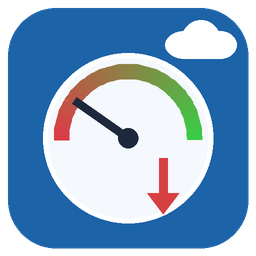

# ioBroker.weather-insights

Weather adapters deliver values. This adapter draws **conclusions** from them: falling pressure means a storm may be coming,
rising pressure means better weather, a small spread between temperature and dew point means fog, and so on.

It works with your own sensors (any state in ioBroker: a weather station, a BME280, Zigbee, Homematic …), with the free
[Open-Meteo](https://open-meteo.com) forecast (no API key), or with both. Every sensor is optional: an input that is not
configured is taken from the forecast of the current hour.

## What you get

| Channel         | Conclusions                                                                                                                                                        |
| --------------- | ------------------------------------------------------------------------------------------------------------------------------------------------------------------ |
| `pressure`      | sea-level pressure, change over 1/3/6/12/24 h, tendency (Met Office scale −4…+4), WMO characteristic of the tendency (code 0…8), **Zambretti** forecast for 6–12 h |
| `storm`         | storm risk 0…3 from the pressure fall/rise in 3 h, "bomb" cyclogenesis in 24 h and measured gusts; storm risk today/tomorrow from the forecast gusts                |
| `humidity`      | dew point, frost point, absolute humidity, spread, cloud base, mugginess                                                                                           |
| `indoor`        | indoor dew point and absolute humidity, mould risk, **ventilation advice** (does opening the window dry the room?)                                                 |
| `wind`          | speed in m/s, Beaufort of wind and gusts, gust factor, change of direction in 3 h (veering/backing)                                                                |
| `temperature`   | felt temperature, wind chill, heat index, humidex, change in 3 h                                                                                                   |
| `frost`         | frost risk 0…3 (ground frost possible, frost expected in the next 18 h, frost now), hoar frost/black ice risk                                                      |
| `fog`           | fog risk 0…3                                                                                                                                                       |
| `thunderstorm`  | thunderstorm risk from local mugginess + falling pressure and from the forecast CAPE; today and tomorrow                                                          |
| `front`         | cold front passed (pressure minimum, then rise and temperature drop) or warm front approaching                                                                    |
| `health`        | **weather sensitivity / migraine** for today, tomorrow and the day after, migraine diary and analysis                                                              |
| `forecast`      | measured minus forecast pressure and temperature (shows a wrong altitude setting or a badly placed sensor)                                                        |
| `summary`       | highest active weather warning and its text                                                                                                                        |

`info.sources` shows for every input whether it came from the sensor or from the forecast.

Text states are written in German if the system language is German, otherwise in English.

## Configuration

**Sensors**: pick the states of your sensors. The units are read from the objects (hPa, Pa, inHg, mmHg; °C, °F, K;
m/s, km/h, mph, kn). An absolute pressure sensor measures the station pressure; it is reduced to sea level with the
altitude. "Detect automatically" compares the value with the forecast (or the standard atmosphere) once at start and
logs the result.

If the pressure state is recorded by the default history instance, the adapter loads the last 24 hours at start, so the
tendency is available immediately. Otherwise it needs 3 hours of data first. The course of the values is kept in the
data directory of the instance and survives restarts.

**Location and forecast**: the location of the system settings is used by default. Leave the altitude empty to use the
elevation of the forecast grid cell; enter the real altitude of the sensor for exact sea-level pressure.

**Weather sensitivity**: sensitivity (low/normal/high) and whether rising, falling or both directions matter.

## Weather sensitivity (migraine)

For every day the adapter looks for the strongest change of the sea-level pressure in any 6-hour window (also 3, 12 and
24 hours for information) and maps it to a level:

| Change in 6 h | Level           |
| ------------- | --------------- |
| below 2 hPa   | 0 – low         |
| 2–4 hPa       | 1 – moderate    |
| 4–6 hPa       | 2 – elevated    |
| 6–9 hPa       | 3 – strong      |
| above 9 hPa   | 4 – very strong |

Sensitivity "high" multiplies the limits by 0.7, "low" by 1.3. `health.today.text` reads e.g.
`Moderate: pressure falling 4.2 hPa, 14:00-20:00`.

These are technical starting values, **not medically validated limits**. To fit them to yourself, press
`health.migraineToday` (or `health.migraineYesterday`) on days with migraine. The adapter keeps the largest 6 h change
of each day in `health.diary` (JSON, editable). With at least 14 days and 3 migraine days, `health.analysis` compares
both groups and `health.suggestedSensitivity` names the sensitivity that separates them best.

## Rules used

- Pressure tendency: UK Met Office terms (steady < 0.1 hPa, slowly 0.1–1.5, rising/falling 1.6–3.5, quickly 3.6–6.0,
  very rapidly > 6.0 hPa in 3 h); characteristic after WMO code table 0200.
- Storm: 3 h fall of 3.6 / 6 / 8 hPa → level 1 / 2 / 3; a quick rise after a low also brings strong wind;
  24 h fall of 24 hPa × sin(latitude)/sin(60°) → level 3; gusts of Beaufort 8 / 9–10 / 11+ → level 1 / 2 / 3.
- Zambretti: Negretti & Zambra, tables as in the widely used implementation by beteljuice, with wind direction and season.
- Dew point: Magnus formula; heat index: NOAA; wind chill: JAG/TI; cloud base: 125 m per K spread.
- Fog: spread ≤ 3 / 2 / 1 K with little wind. Frost: air ≤ 0 °C now, forecast minimum ≤ 0 °C in 18 h, ≤ 3 °C possible ground frost.
- Thunderstorms: CAPE ≥ 300 / 1000 / 2500 J/kg; locally ≥ 25 °C with dew point ≥ 16 °C, more with falling pressure.

## Changelog

<!--
   Placeholder for the next version (at the beginning of the line):
   ### **WORK IN PROGRESS**
-->

### **WORK IN PROGRESS**

- (@GermanBluefox) initial release

## License

MIT License

Copyright (c) 2026 bluefox <dogafox@gmail.com>

Permission is hereby granted, free of charge, to any person obtaining a copy
of this software and associated documentation files (the "Software"), to deal
in the Software without restriction, including without limitation the rights
to use, copy, modify, merge, publish, distribute, sublicense, and/or sell
copies of the Software, and to permit persons to whom the Software is
furnished to do so, subject to the following conditions:

The above copyright notice and this permission notice shall be included in all
copies or substantial portions of the Software.

THE SOFTWARE IS PROVIDED "AS IS", WITHOUT WARRANTY OF ANY KIND, EXPRESS OR
IMPLIED, INCLUDING BUT NOT LIMITED TO THE WARRANTIES OF MERCHANTABILITY,
FITNESS FOR A PARTICULAR PURPOSE AND NONINFRINGEMENT. IN NO EVENT SHALL THE
AUTHORS OR COPYRIGHT HOLDERS BE LIABLE FOR ANY CLAIM, DAMAGES OR OTHER
LIABILITY, WHETHER IN AN ACTION OF CONTRACT, TORT OR OTHERWISE, ARISING FROM,
OUT OF OR IN CONNECTION WITH THE SOFTWARE OR THE USE OR OTHER DEALINGS IN THE
SOFTWARE.
